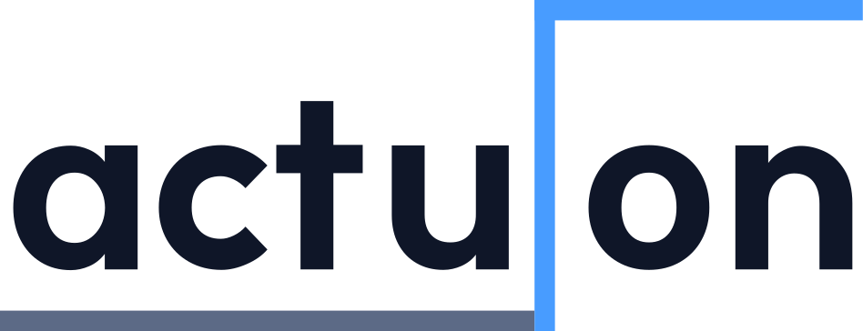
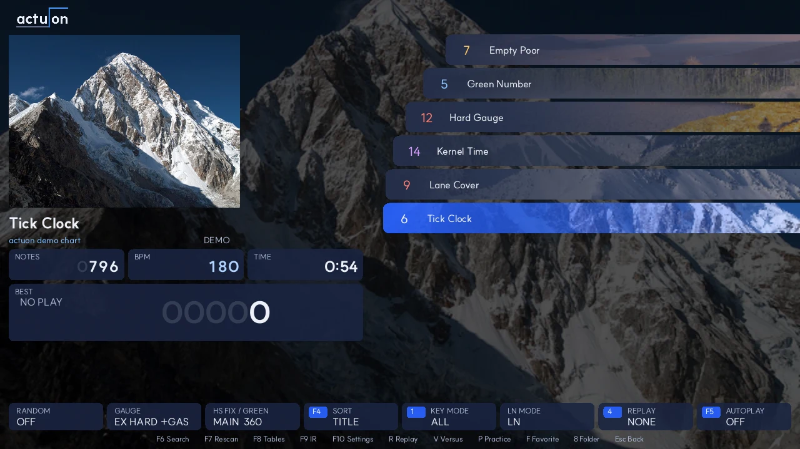
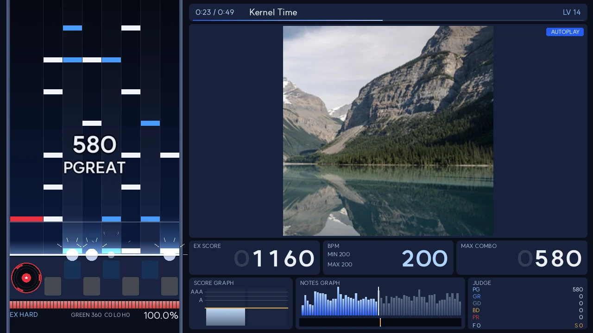
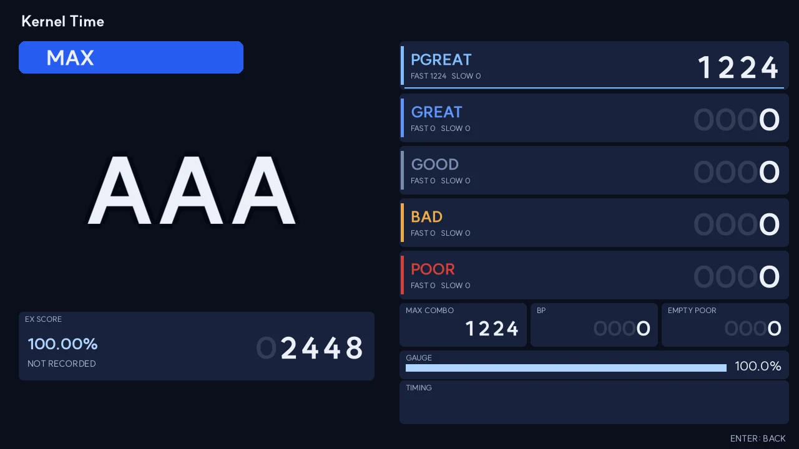
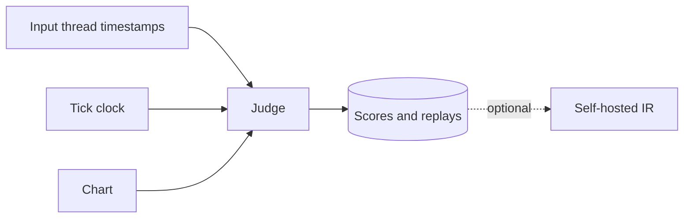

<div align="center">

<picture>
  <source media="(prefers-color-scheme: dark)" srcset="assets/brand/actuon_widelogo.svg">
  
</picture>

**Nothing between you and the note.**

The next-generation BMS player.

[](https://github.com/square3ang/actuon/actions/workflows/ci.yml)
[](LICENSE)
[](https://ziglang.org)

[Quick start](#quick-start) · [Controls](#controls) · [Features](#features) · [Docs](#documents)

</div>

> [!NOTE]
> **Public beta preparation.** See [docs/compat.md](docs/compat.md) for what works and what does not yet.



<p>
  
  
</p>

<sub>Screens show demo charts. Photographs, cropped: <a href="https://commons.wikimedia.org/wiki/File:Pumori,_Nepal,_Asia.jpg">Vyacheslav Argenberg</a> (CC BY 4.0), <a href="https://commons.wikimedia.org/wiki/File:Lake_Kinney_mit_Mount_Whitehorn.jpg">Florian Fuchs</a> (CC BY 3.0), via Wikimedia Commons. Retake them with <code>tools/site_shots.py</code>.</sub>

## Features

| | |
| --- | --- |
| **Platforms** | Windows, macOS, Linux |
| **Input** | Never waits for the frame: RawInput and IOKit HID on their own thread; on Linux compositor timestamps, or more exact kernel ones with evdev |
| **Formats** | BMS, BME, BML, PMS, BMSON; Shift-JIS, EUC-KR, UTF-8 |
| **Modes** | 4K, 5K, 6K, 7K, 10K, 14K, 9K |
| **Your data** | Imports beatoraja and LR2 score databases |
| **Tables** | Difficulty tables and courses, with chart downloads |
| **Skins** | beatoraja, LR2 and osu! mania skins, chosen per screen and key mode |
| **BGA** | Still images and FFmpeg video, with optional deblocking and FSRCNNX upscaling |
| **Online** | Verified rankings at [ir.actuon.app](https://ir.actuon.app), with sign-up in the game. Host your own with [`server/`](server) |



## Quick start

Download the package for your OS from [Releases](https://github.com/square3ang/actuon/releases/latest): a zip for Windows, a dmg for macOS, an AppImage for Linux.

1. Press <kbd>F10</kbd> for settings and add a library folder. Charts are scanned in the background.
2. <kbd>Enter</kbd> opens a folder or starts a chart. <kbd>Esc</kbd> leaves play.

To build from source, you need Zig 0.17.x and these libraries, found through pkg-config: SDL3, SDL3_ttf, PortAudio, SQLite, Lua 5.4,
libarchive and FFmpeg (avformat, avcodec, avfilter, avutil, swscale). Linux also needs Vulkan.
Shaders build from WGSL with `naga` (`cargo install naga-cli`); Windows and macOS also need `spirv-cross`. On Windows, use MSYS2's `portaudio-asio` for ASIO output.
With Homebrew, add the `lib/pkgconfig` of `libarchive`, `lua@5.4` and `sqlite` to `PKG_CONFIG_PATH`.

```sh
zig build -Doptimize=ReleaseSafe
./zig-out/bin/actuon
```

Packaging scripts for each OS are in [`packaging/`](packaging). To release, set `.version` in `build.zig.zon` and push the tag `v` plus that version: CI publishes the packages, and the game offers them under Settings, Online.

## Controls

| Key | Action |
| --- | --- |
| <kbd>F4</kbd> <kbd>F5</kbd> | Sort, autoplay |
| <kbd>F6</kbd> <kbd>F7</kbd> <kbd>F8</kbd> | Search, rescan, update difficulty tables |
| <kbd>F9</kbd> <kbd>F10</kbd> | IR ranking and rivals, settings. Random, gauge and its auto shift, HS fix, LN mode, judge algorithm, score target and the assists are under Settings, Play and Assist (CN and HCN plays have their own scores and replays, and stay off the IR; an assisted play is not saved) |
| <kbd>1</kbd> <kbd>2</kbd> | Key mode filter, sort |
| <kbd>4</kbd> <kbd>R</kbd> | Replay slot, play that replay |
| <kbd>F</kbd> <kbd>P</kbd> | Favorite the chart, practice a section of the chart |
| <kbd>V</kbd> | Versus room: create one for the chart, or join by code. Needs an IR account |
| <kbd>F12</kbd> | Screenshot, on any screen, into `screenshots/` in the data folder |
| <kbd>T</kbd> | Timing graph over a skin's result screen |
| <kbd>6</kbd> <kbd>7</kbd> <kbd>8</kbd> <kbd>0</kbd> | Key settings, the chart's IR page in the browser, the chart's folder, search |
| Start, Select | With **beatoraja controls** on (Settings, Controls): 7 key inputs work as in beatoraja. Hold for option panels in song select, with a key for speed in play, both for 1 second to quit; press Start twice to show or hide the lane cover. <kbd>3</kbd> and <kbd>9</kbd> change the LN mode and score target |
| <kbd>↑</kbd> <kbd>↓</kbd> | Green number while playing |
| <kbd>Page Up</kbd> <kbd>Page Down</kbd> | Lane cover while playing |
| <kbd>←</kbd> <kbd>→</kbd> or mouse click | Seek in autoplay: 5 s steps, or to the clicked fraction of the song |

Key bindings and audio devices are in settings. `actuon latency` measures your setup.

<details>
<summary><b>Input setup</b></summary>

Windows needs no setup. macOS asks for the Input Monitoring permission; if you refuse, the player uses SDL's keyboard events.

Linux needs no setup either: SDL's keyboard events carry the compositor's timestamps, not the frame's. For more exact kernel timestamps and key polling, turn on **evdev input** in Settings, Controls. It reads `/dev/input`, so add yourself to the `input` group and log in again:

```sh
sudo usermod -aG input $USER
```

> **Warning:** this lets every program you run read all keystrokes. Do it only on a machine you trust.

</details>

<details>
<summary><b>Chart downloads</b></summary>

Press <kbd>Enter</kbd> on a chart a table lists but you do not own. See `download_url` in `config.json`. The default
source is a third-party service. Packages land in `<first library folder>/downloads/`.

</details>

<details>
<summary><b>Crash reports</b></summary>

A crash writes `crash.txt` to the data folder, and the next start moves it to `crash-last.txt` and says so. Nothing is
sent anywhere. Attach the file to a bug report if you want to.

</details>

## Documents

| | |
| --- | --- |
| [Rules and sources](docs/spec.md) | How judging and parsing are defined |
| [Compatibility](docs/compat.md) | What works and what does not yet |
| [Skins](docs/skin.md) | Skin formats and options |
| [Editor preview](docs/editors.md) | Previewing from a chart editor |
| [IR server](docs/ir.md) | Hosting your own rankings |
| [Licenses](docs/licenses.md) | Third-party licenses |

## License

[GPLv3](LICENSE).
